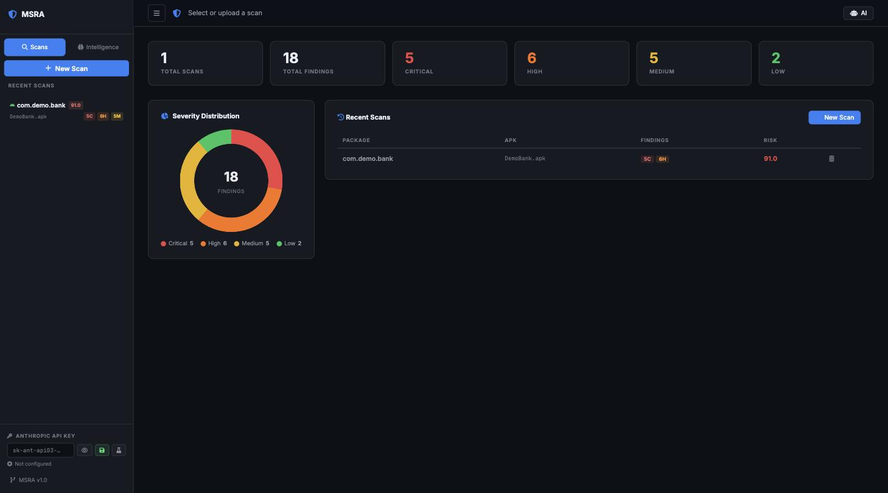
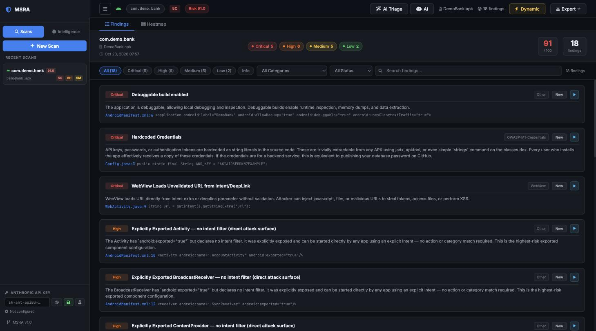
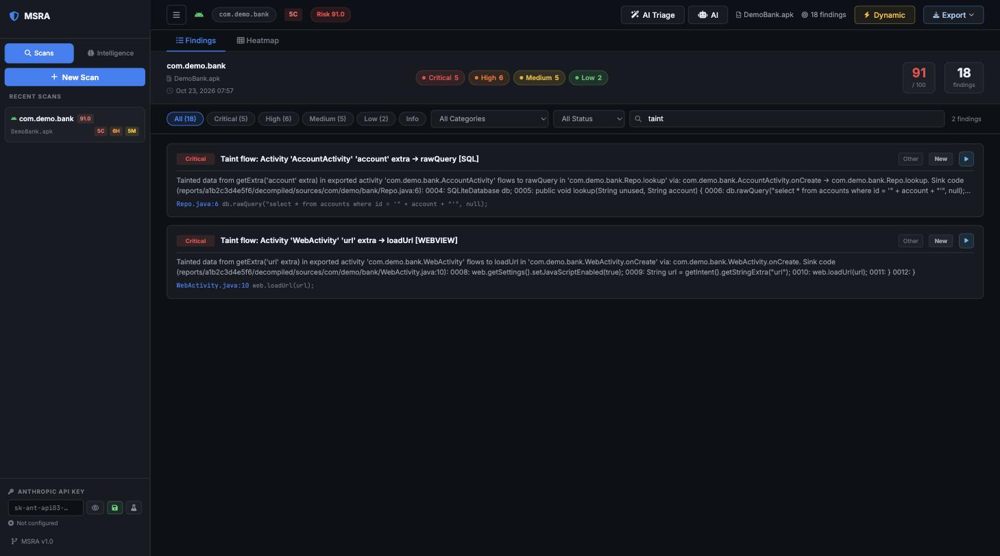
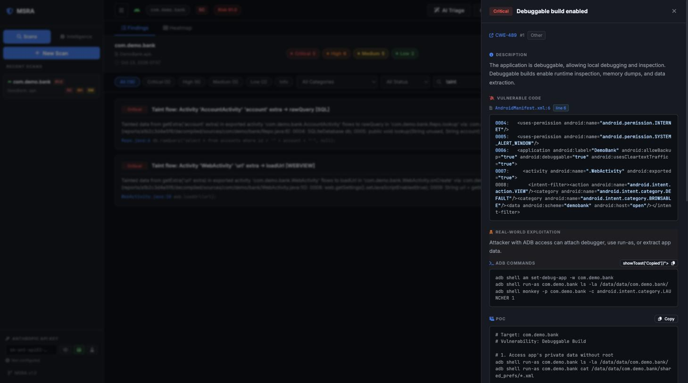
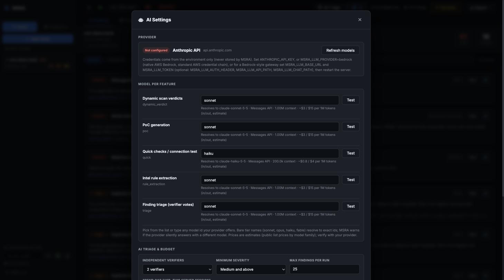

# MSRA — Mobile Security Review Assistant


MSRA is a multi-platform security scanner and web dashboard built for penetration testers and security researchers. It automates the tedious parts of mobile app security reviews — upload an APK, IPA, JAR, or EXE and within minutes get a fully triaged vulnerability report mapped to OWASP Mobile Top 10, CWEs, and severity ratings.

It goes beyond pattern matching: MSRA decompiles Android apps with jadx and runs inter-procedural taint analysis to trace real data flows from source to sink. It then drives ADB to dynamically probe exported components with SQLi, path traversal, and intent injection payloads — confirming whether static findings are actually exploitable at runtime. Findings come with ready-to-use `adb` PoC commands so pentesters can move straight to exploitation and reporting.

**AI (optional, bring your own provider):** Pick a model per feature in the AI Settings dialog (Anthropic API, native AWS Bedrock, or a Bedrock-style gateway). AI triage runs independent verifier votes over each finding, dynamic scans get a true positive / false positive / uncertain verdict with reasoning, and the Intelligence Hub turns blog posts and CVEs into candidate detection rules that stay **disabled until you review them**. Secrets are masked before anything is sent to a model, and the app learns from your triage which rules are noisy. Everything else runs fully offline.

## Screenshots

| Dashboard | Findings |
|---|---|
|  |  |
| **Taint flows** | **Finding detail with PoC** |
|  |  |



*Screenshots show a synthetic demo app (`com.demo.bank`) with deliberately planted vulnerabilities.*

## Highlights

- **Taint analysis that checks its work** — call-chain flows are only marked verified when the tainted argument is traced into the callee's parameter all the way to the sink
- **Secrets, SBOM and hybrid apps** — masked secret detection, CycloneDX SBOM with optional OSV lookup, React Native / Flutter / Xamarin / Unity payload scanning
- **Hardened by default** — loopback bind, optional token auth, SSRF-safe fetching, ReDoS-guarded rules, crawled/AI rules imported disabled
- **Web Dashboard** — Upload files, browse scans, triage findings in a single-page UI
- **215+ Security Patterns** — Android (77), iOS (45), Java JAR (49), Windows PE (44)
- **Multi-Platform Scanning** — APK / APKM / XAPK · IPA · JAR · EXE / DLL
- **Dynamic Verification** — ADB-based probes (no API key) or AI-enhanced Claude analysis
- **AI PoC Generation** — Generate proof-of-concept code for confirmed findings
- **Intelligence Hub** — Community rules, custom pattern editor, HackerOne / OWASP feeds
- **Exports** — PDF, CSV, SARIF, JSON — all with triage state included

---

## Installation

### Option 1 — Shell script (macOS / Linux, recommended)

```bash
git clone https://github.com/BaymaxPop23/MSRA.git
cd MSRA

# Install Python dependencies
pip3 install -r requirements.txt

# macOS system tools
brew install jadx android-platform-tools

# Linux system tools
# sudo apt install jadx adb

# Start (opens browser automatically)
./start.sh
```

To enable AI features, set your Anthropic API key before starting:

```bash
ANTHROPIC_API_KEY=sk-ant-... ./start.sh
```

Or add it to a `.env` file (copy from `.env.example`).

---

### Option 2 — Make

```bash
git clone https://github.com/BaymaxPop23/MSRA.git
cd MSRA
make install      # pip install dependencies
make start        # start dashboard, open browser
make stop         # stop dashboard
make restart      # restart
make update       # pull latest version and restart
make logs         # tail server logs
```

---

### Option 3 — Docker (no Python setup needed)

```bash
git clone https://github.com/BaymaxPop23/MSRA.git
cd MSRA

# Add your API key (optional, for AI features)
cp .env.example .env
# edit .env and set ANTHROPIC_API_KEY=sk-ant-...

docker compose up -d
# Open http://localhost:5001

docker compose down   # stop
```

Scan data and reports persist in Docker volumes across restarts.

---

## Security & configuration

MSRA drives real devices and parses untrusted files, so it is locked down by default:

| Setting | Default | Purpose |
|---|---|---|
| `--host` / `MSRA_HOST` | `127.0.0.1` | Bind address. `--debug` is refused on non-loopback hosts. |
| `MSRA_AUTH_TOKEN` | unset | Require a token. Browsers sign in at `/login` (token in the POST body, never the URL); scripts send `Authorization: Bearer <token>`. |
| `MSRA_ALLOWED_HOSTS` | unset | Extra `Host` names accepted when no token is set (DNS-rebinding guard). |
| `MSRA_AUTO_INSTALL` | unset | Set to `1` to auto-install scanned APKs on a connected device (off by default). |
| `MSRA_DB_PATH` | `./msra.db` | SQLite location (Docker keeps it on the data volume). |
| `MSRA_CLAUDE_MODEL`, `MSRA_CLAUDE_FAST_MODEL` | built-in | Models used for AI features. |
| `MSRA_JADX_TIMEOUT` | 300 (server) / 600 (CLI) | Seconds before jadx is abandoned. |
| `MSRA_DYN_JOB_TIMEOUT` | 900 | Time budget per dynamic job in seconds (clamped to 60-3600). Timed-out jobs are marked failed and the device is cleaned up. |

Exposing the dashboard beyond localhost? Set `MSRA_AUTH_TOKEN` and put it behind HTTPS. With Docker, the port is published on `127.0.0.1` unless you set `MSRA_BIND`.

Run the tests with `make test` (needs `pip install pytest`).

---

## Scanner coverage notes

- **Hybrid apps:** React Native bundles (plain JS and Hermes bytecode), Flutter `libapp.so`, Xamarin assemblies and Unity metadata are detected and scanned for hardcoded secrets, since jadx only decompiles the Java/Kotlin shell.
- **Taint + ICC:** the web scan and the CLI (`msra scan`, skip with `--no-taint`) both run the inter-procedural taint engine and the exported-component ICC chain analysis.
- **SBOM / vulnerable dependencies:** libraries are inventoried offline from build metadata (CycloneDX 1.5 at `/api/scans/<id>/sbom.json`). Set `MSRA_OSV_LOOKUP=1` to check them against OSV.dev; only public `group:artifact` + version coordinates are sent.
- **Permission rules** (`permission-install-packages`, `-system-alert-window`, `-bind-accessibility`, `-device-admin`) are evaluated natively and respect the Intelligence Hub toggles.

## Operations & scaling

| Variable | Default | Purpose |
|---|---|---|
| `MSRA_SCAN_WORKERS` | 2 | Concurrent scans (decompile + analysis is CPU/RAM heavy; extra uploads queue). Clamped 1-32 |
| `MSRA_DYN_WORKERS` | 3 | Concurrent dynamic verification jobs (still serialised per device) |
| `MSRA_AI_WORKERS` | 2 | Concurrent AI triage jobs |
| `MSRA_UPLOAD_TTL_HOURS` | off | Delete leftover uploads older than this (never for active scans) |
| `MSRA_DECOMPILED_TTL_DAYS` | off | Delete old `decompiled/` trees; reports and findings are kept (dynamic/AI re-checks of that scan need a rescan) |
| `MSRA_DB_PATH` | `./msra.db` | SQLite location (WAL, busy-timeout, indexed) |

`GET /healthz` is an unauthenticated liveness probe (returns `{"ok": true}` only); the Docker healthcheck uses it, so it keeps working when `MSRA_AUTH_TOKEN` is set. `GET /api/queue/status` shows pool depths. Responses carry `nosniff`/frame/referrer headers. SQLite plus an in-process queue targets a single node; for multiple nodes put scans behind a shared queue and move the DB to a server database first.

## AI features

Everything AI is optional; scanning works fully offline without it. Open **AI** in the top bar to configure.

**Providers** (credentials come from the environment only - MSRA never stores them):

| Provider | Set |
|---|---|
| Anthropic (default) | `ANTHROPIC_API_KEY` |
| Native AWS Bedrock (boto3 Converse; `pip install boto3`) | `MSRA_LLM_PROVIDER=bedrock` + `MSRA_BEDROCK_REGION` (or `AWS_REGION`); credentials from the standard AWS chain (`AWS_PROFILE`, SSO, env keys, instance role) - MSRA never reads them |
| Bedrock-style LLM gateway | `MSRA_LLM_BASE_URL` + `MSRA_LLM_TOKEN` (optional: `MSRA_LLM_AUTH_HEADER`, `MSRA_LLM_API_PATH`, `MSRA_LLM_CHAT_PATH`, `MSRA_LLM_MODELS_PATH`) |

**AI researcher.** Triage judges a code snippet; the researcher investigates. Open a finding and press *Investigate with AI*: the model states a hypothesis, then reads the scan's decompiled sources with read-only tools (`read_file`, `search`, `callers`, `manifest`, `list_dir`), traces entry point to sink, looks for what would *disprove* the finding, and writes a report (root cause, attack scenario, preconditions, safe way to confirm, remediation, what it could not verify, other leads). Every `file:line` it cites is re-checked against the real files; a "likely real" verdict without a verifiable citation is downgraded to unsure. Tools are confined to the scan's decompiled directory (no traversal or symlink escape, plain-substring search only), code and tool output are treated as untrusted data, and the model can only choose from the fixed tool list. It is advisory and never changes findings, rules or your triage status. Bounded by max steps and max spend per finding (AI Settings) plus the global budget. API: `POST/GET /api/scans/<id>/findings/<fid>/ai-research`.

Gateway behaviour (ported from the pentest harness): non-Claude models are routed to chat-completions and normalised back; the system prompt is sent with `cache_control` and automatically falls back to the plain form if the gateway rejects it; models that want `max_completion_tokens` are detected and remembered; a "prompt too long" 400 is retried once with the prompt's middle trimmed; `Retry-After` (seconds or HTTP-date) is honoured; redirects are never followed (the auth header can't leak). Debug aids: `MSRA_LLM_DEBUG_LOG=<file>` (masked raw log) and `MSRA_LLM_MOCK=1` (no-network provider). Disable caching with `MSRA_LLM_PROMPT_CACHE=0`.

With a gateway, Claude models use the Messages API and every other vendor (DeepSeek, Qwen, Llama, Nova, ...) is routed to chat-completions automatically. The model list is fetched live from the gateway.

**Choose a model per feature** in *AI Settings*: finding triage, dynamic scan verdicts, PoC generation, intel rule extraction and quick checks. Pick from the catalog or type any model id; bare names (`sonnet`, `opus`, `haiku`, `fable`) resolve to exact ids, and MSRA warns when a provider silently answers with a different model. Each row shows the API used, context window and an estimated price, and has a **Test** button. Set a **spend cap** to stop AI calls once it is reached.

**AI Triage** reviews un-triaged findings with N independent verifiers, each through a different lens (reachability, input control, mitigations). A finding is called *likely real* only when all N agree and *likely false positive* only on a majority. Results show as badges on the findings list and in the finding drawer. They are advisory: your own triage decision always wins, and findings you have already triaged are skipped.

**It learns from you.** Every False Positive / Confirmed decision is tallied per rule. Rules you keep rejecting are listed in *AI Settings -> Learning from your triage* (with a one-click disable), a rule's track record is shown next to its findings, and the AI verifier is told each rule's history.

**Safety.** Anything originating in an app or on the web (code snippets, logcat, blog text) is wrapped in a random per-request delimiter and treated strictly as data; secrets and tokens are masked before text is sent to a model. Rules produced from AI or crawled content are imported **disabled** under server-generated ids and must be enabled by an analyst.

| Setting | Default | Purpose |
|---|---|---|
| `MSRA_AI_CONFIG` | `data/custom/ai_config.json` | Where model choices/budget are saved (no credentials). |
| `MSRA_CLAUDE_MODEL`, `MSRA_CLAUDE_FAST_MODEL` | unset | Legacy defaults, used until you pick a model in the UI. |

---

## Updating

MSRA ships an `update.sh` script that pulls the latest code, updates dependencies, and restarts the server in one step.

### Quickest way

```bash
./update.sh
```

The script will:
1. Show your current version and any new commits available
2. Ask for confirmation before applying
3. `git pull` the latest code
4. `pip3 install -r requirements.txt` to pick up new dependencies
5. Restart the server automatically

### With Make

```bash
make update
```

### Manual update (Docker)

```bash
git pull origin main
docker compose down
docker compose up -d --build
```

### Manual update (no script)

```bash
cd MSRA
git pull origin main
pip3 install -r requirements.txt
./stop.sh && ./start.sh
```

> **Note:** The SQLite database (`msra.db`) and all scan reports in `reports/` are never touched by an update — your data is safe.

---

## Requirements

### Python (required)

| Package | Purpose |
|---|---|
| Python 3.9+ | Runtime — [python.org](https://python.org) |
| `flask` | Web server |
| `weasyprint` | PDF report export |
| `pefile` | Windows PE / EXE / DLL scanning |

Install all Python packages at once:
```bash
pip3 install -r requirements.txt
```

### System libraries — WeasyPrint PDF export

WeasyPrint requires native system libraries. **Without these, PDF export will not work.**

**macOS:**
```bash
brew install pango cairo gdk-pixbuf
```

**Ubuntu / Debian:**
```bash
sudo apt install libpango-1.0-0 libcairo2 libgdk-pixbuf-2.0-0
```

**Fedora / RHEL:**
```bash
sudo dnf install pango cairo gdk-pixbuf2
```

> `start.sh` will print a warning at startup if WeasyPrint is not working correctly.

### External tools

| Tool | Purpose | Install |
|---|---|---|
| `jadx` | APK decompilation (required for Android scans) | `brew install jadx` / `apt install jadx` |
| `adb` | Dynamic analysis — ADB probes (optional) | `brew install android-platform-tools` |
| `frida-tools` | Runtime instrumentation hooks (optional) | `pip3 install frida-tools` |

### AI features (optional)

Set `ANTHROPIC_API_KEY` to enable:
- AI-Enhanced Dynamic Scan (Claude verdict + reasoning)
- PoC code generation
- Intelligence Hub — URL-to-rule extraction and feed analysis

```bash
export ANTHROPIC_API_KEY=sk-ant-...
# or add to .env (copy from .env.example)
```

Get a key at [console.anthropic.com](https://console.anthropic.com). All scanning and heuristic dynamic analysis works fully offline without a key.

---

## Usage

Upload a file through the dashboard, then:

- Browse findings with severity chips and risk score
- Click a finding to open the detail drawer: vulnerable code, exploitation details, commands
- Run **Basic ADB Scan** (heuristic verdict, no API key) or **AI-Enhanced Scan** (Claude analysis)
- Generate PoC code / Android apps for confirmed findings
- Export as PDF, CSV, SARIF, or JSON
- Triage findings: Confirmed / False Positive / Accepted Risk / Fixed

### Supported File Types

| File | Platform | Scanner |
|------|----------|---------|
| `.apk` `.apkm` `.xapk` | Android | jadx decompile + 77 patterns |
| `.ipa` | iOS | plist / entitlements / binary + 45 patterns |
| `.jar` | Java | manifest + class files + 49 patterns |
| `.exe` `.dll` | Windows PE | PE headers + imports + strings + 44 patterns |

### Dynamic Analysis (Android)

The dashboard auto-detects connected ADB devices (including Genymotion at `127.0.0.1:6555`).

**Basic ADB Scan** — runs targeted ADB probes per finding category and produces a heuristic verdict without an API key. Probes include:
- SQLi: 4 payload classes against ContentProvider + open query
- Path traversal: 4 encoded variants
- WebView: JS-scheme deeplink + file:// URI + intent-extras injection
- Credentials: world-readable file scan + external storage + SharedPrefs
- Network: NSC config read + cleartext HTTP detection
- Components: exported component enumeration via `dumpsys`

**AI-Enhanced Scan** — same probes + passes security-filtered evidence to Claude with category-specific guidance for intelligent verdict and suggested actions.

---

## Vulnerability Categories

### Android (77 patterns)
| Category | Patterns |
|---|---|
| WebView | 18 |
| Intent / DeepLink | 13 |
| Component Exposure | 11 |
| Network Security | 12 |
| Cryptography | 10 |
| Data Storage | 8 |
| Permissions | 7 |
| Hardcoded Secrets | 7 |
| Input Validation | 4 |
| Logging | 4 |

### iOS (45 patterns)
ATS misconfiguration, insecure data storage, weak cryptography, URL scheme hijacking, Objective-C runtime abuse, entitlement misuse, binary protections.

### Java JAR (49 patterns)
Log4Shell / Spring4Shell / Commons Collections, deserialization gadget chains, code injection, weak crypto, manifest security, known-vulnerable library versions.

### Windows PE (44 patterns)
Missing ASLR / DEP / CFG / StackCookie / High-Entropy ASLR / Authenticode, process injection triad, credential theft APIs (MiniDumpWriteDump, DPAPI, CredRead), ransomware API combos, persistence, anti-analysis, string IOCs.

---

## Project Structure

```
MSRA/
├── start.sh               # One-command start (opens browser)
├── stop.sh                # Stop server
├── update.sh              # Pull latest version and restart
├── Makefile               # make start / stop / update / logs / docker
├── Dockerfile             # Docker image
├── docker-compose.yml     # Docker Compose with persistent volumes
├── requirements.txt       # Python dependencies
├── server.py              # Flask web server & dashboard (~6500 lines)
├── main.py                # CLI entry point
├── msra/
│   ├── scanner.py         # Android pattern-based scanner
│   ├── ios_scanner.py     # iOS IPA static scanner
│   ├── jar_scanner.py     # Java JAR static scanner
│   ├── exe_scanner.py     # Windows PE static scanner
│   ├── report.py          # HTML report generation
│   ├── db.py              # SQLite persistence (WAL mode)
│   ├── rules_api.py       # Pattern management API (cached)
│   ├── pdf_export.py      # PDF / SARIF / CSV export
│   ├── corellium.py       # Corellium cloud device client
│   ├── deep_analysis/     # WebView, Intent, Provider analyzers
│   └── dynamic/           # ADB / Frida / mitmproxy dynamic analysis
└── data/
    └── builtin/
        ├── patterns.json      # 77 Android patterns
        ├── ios_patterns.json  # 45 iOS patterns
        ├── jar_patterns.json  # 49 JAR patterns
        └── exe_patterns.json  # 44 Windows PE patterns
```

---

## Custom Patterns

Create rules in the dashboard (**Intelligence Hub → Custom Rules → New Rule**) or add them directly to `data/custom/user_rules.json`:

```json
{
  "patterns": [
    {
      "id": "custom-001",
      "title": "Dangerous Method Call",
      "severity": "High",
      "category": "Custom",
      "detection": {
        "type": "regex",
        "patterns": [{"pattern": "dangerousMethod\\s*\\(", "file_types": [".java"]}]
      },
      "description": "Calls to dangerousMethod() may allow...",
      "remediation": "Replace with safeMethod().",
      "enabled": true
    }
  ]
}
```

---

## Contributing

1. Fork the repository
2. Create a feature branch (`git checkout -b feat/my-patterns`)
3. Add patterns to the appropriate `data/builtin/*.json` file
4. Submit a pull request

## License

MIT License

## Acknowledgments

- [jadx](https://github.com/skylot/jadx) — APK decompilation
- [pefile](https://github.com/erocarrera/pefile) — Windows PE parsing
- [OWASP Mobile Security](https://owasp.org/www-project-mobile-security/) — Security guidance
- [Claude](https://claude.ai) — AI-powered analysis
